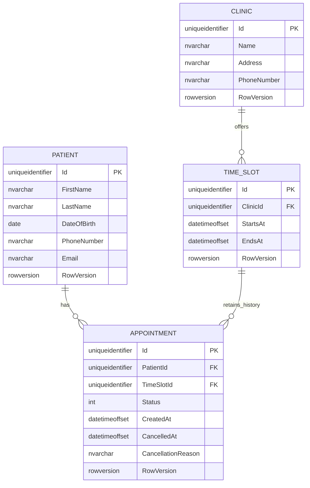
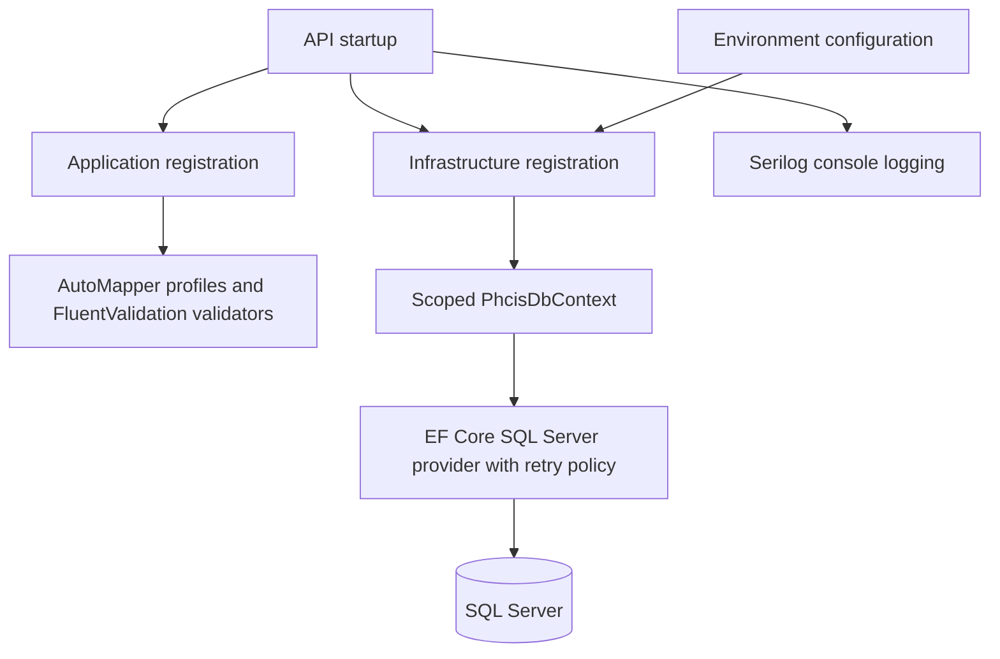
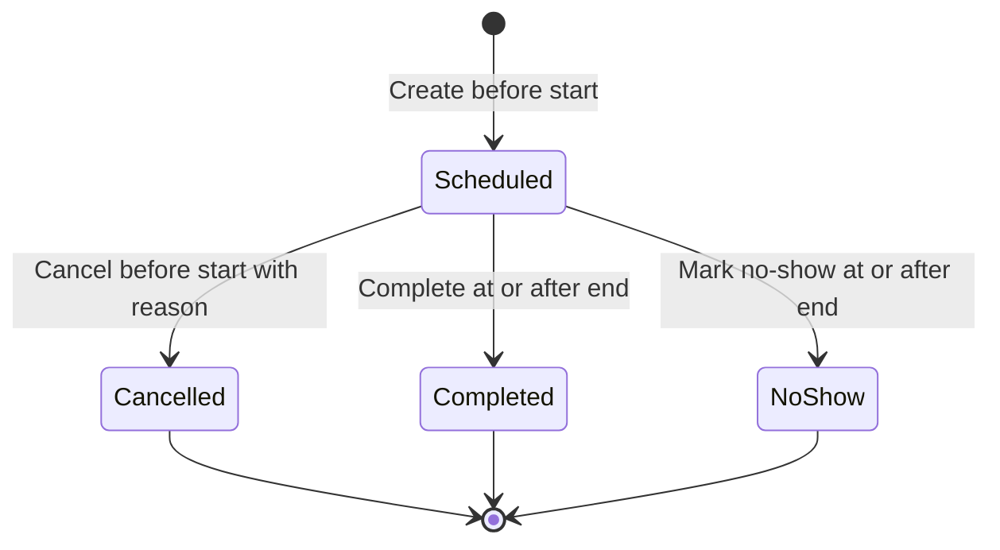
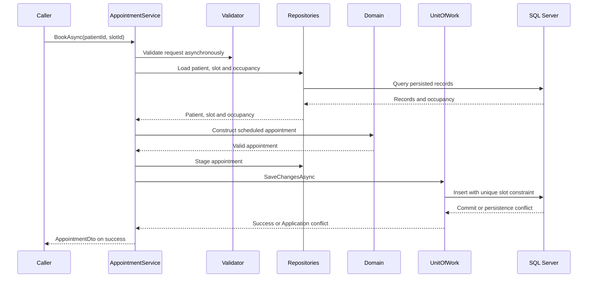

# PHCIS Clinic Booking System

> **Current local setup:** [SQL Server and EF Identity run guide](documentation/LOCAL_DEVELOPMENT.md).
> The portal now uses simple email/password login backed by EF Core Identity, not external OIDC/JWT.
> Set `ConnectionStrings:Phcis` in the API appsettings file and start the API; pending EF migrations run automatically. See the [SQL Server setup guide](documentation/LOCAL_DEVELOPMENT.md#use-your-own-sql-server).
> Open the solution in Visual Studio, select the **API and Blazor** launch profile, and press **F5**. The frontend opens `/login`; the API applies pending migrations and the configured Development clinic/slot seed.
> Use **Shift+F5** before rebuilding. See the [Visual Studio setup instructions](documentation/LOCAL_DEVELOPMENT.md#run-from-visual-studio).
> Development startup seeds four fictional clinics and future weekday time slots in your configured SQL Server. Set `Development:SeedClinicsAndSlots=false` to disable it; no demo login is created by this setting.
> Authorized administrators can add more clinics through **Clinics > Manage clinics**. Configure their Identity account IDs as described in the [clinic management guide](documentation/LOCAL_DEVELOPMENT.md#add-clinics-through-the-app).
> Development can seed `admin@phcis.local` with clinic-administration access automatically, without copying account IDs. Configure `Development:AdministratorPassword` in API user secrets and start with F5; see the current run guide.
> **Manage clinics** also supports editing clinic details, adding/editing/closing/reopening future slots, and granting administrator access to another registered account. Booked slots and appointment history are protected.
> Earlier OIDC setup notes below are retained as historical reference and are not the current run instructions.

## Scenario Overview

You are tasked with designing and implementing a simplified Clinic Booking System for PHCIS (Primary Health Care Information System). The system should allow patients to book appointments at clinics, view available time slots, and receive confirmation. 

## Software Requirements Specification (SRS)

**Project:** Primary Health Care Information System (PHCIS)  
**Module:** Clinic Appointment Booking System  
**Document Type:** Requirements Analysis  
**Version:** 1.0  
**Status:** Initial Requirements Specification

### 1.1 Purpose

The purpose of this document is to define the functional and non-functional requirements for the PHCIS Clinic Booking System.

The system is designed to simplify the process of booking, managing, and tracking clinic appointments within primary healthcare facilities.

This document serves as a reference for system design, development, testing, and future maintenance.


### 1.2 Technologies

The system must use the technologies and development tools permitted or required by the assessment instructions.

## Folder Structure

```text
PHCIS/
├── PHCIS_Clinic_Booking_System.slnx
├── backend/
│   ├── PHCIS.Api/
│   │   ├── Authentication/
│   │   ├── Contracts/
│   │   ├── Controllers/
│   │   ├── Errors/
│   │   ├── DependencyInjection.cs
│   │   ├── PHCIS.Api.csproj
│   │   ├── Program.cs
│   │   ├── appsettings.json
│   │   ├── appsettings.Development.json
│   │   └── Properties/
│   │       └── launchSettings.json
│   ├── PHCIS.Application/
│   │   ├── Abstractions/
│   │   ├── Exceptions/
│   │   ├── Mapping/
│   │   ├── Models/
│   │   ├── Services/
│   │   ├── Validation/
│   │   ├── DependencyInjection.cs
│   │   └── PHCIS.Application.csproj
│   ├── PHCIS.Domain/
│   │   ├── Common/
│   │   ├── Entities/
│   │   ├── Exceptions/
│   │   └── PHCIS.Domain.csproj
│   ├── PHCIS.Infrastructure/
│   │   ├── Persistence/
│   │   │   ├── Configurations/
│   │   │   ├── Migrations/
│   │   │   ├── Repositories/
│   │   │   ├── PhcisDbContext.cs
│   │   │   ├── PhcisDbContextFactory.cs
│   │   │   └── UnitOfWork.cs
│   │   ├── DependencyInjection.cs
│   │   └── PHCIS.Infrastructure.csproj
│   └── PHCIS.UnitTests/
│       ├── ApiAuthenticationTests.cs
│       ├── ApiFactory.cs
│       ├── ApiTests.cs
│       ├── ApplicationPersistenceTests.cs
│       ├── ApplicationServiceFixture.cs
│       ├── AppointmentServiceTests.cs
│       ├── AppointmentTests.cs
│       ├── AvailabilityServiceTests.cs
│       ├── DomainTestData.cs
│       ├── EntityPersistenceTests.cs
│       ├── EntityTests.cs
│       ├── InfrastructureTests.cs
│       ├── SwaggerTests.cs
│       ├── ValidationTests.cs
│       └── PHCIS.UnitTests.csproj
├── frontend/
│   ├── PHCIS.Web/
│   │   ├── Components/
│   │   ├── Configuration/
│   │   ├── Layout/
│   │   ├── Models/
│   │   ├── Pages/
│   │   ├── Services/
│   │   ├── Validation/
│   │   ├── wwwroot/
│   │   ├── Program.cs
│   │   └── PHCIS.Web.csproj
│   └── PHCIS.Web.Tests/
│       ├── ApiClientTests.cs
│       ├── AuthorizationHandlerTests.cs
│       ├── ComponentTests.cs
│       ├── FormValidationTests.cs
│       └── PHCIS.Web.Tests.csproj
├── documentation/
├── README.md
└── LICENSE
```

Generated `bin` and `obj` folders are omitted. All five backend projects and both frontend projects target .NET 10 and are included in the existing solution. Frontend code remains under the separate root-level `frontend` directory.

## Layer References

Each arrow means "has a project reference to":

```text
PHCIS.Api            -> PHCIS.Application, PHCIS.Infrastructure
PHCIS.Application    -> PHCIS.Domain
PHCIS.Infrastructure -> PHCIS.Application, PHCIS.Domain
PHCIS.UnitTests      -> PHCIS.Application, PHCIS.Domain, PHCIS.Infrastructure
PHCIS.Domain         -> (no project references)
PHCIS.Web            -> (no backend project references; HTTP API only)
PHCIS.Web.Tests      -> PHCIS.Web
```

- **PHCIS.Domain** is intended to hold core entities and business rules. It has no dependencies on the other projects.
- **PHCIS.Application** is intended to hold use cases and interfaces, using Domain types.
- **PHCIS.Infrastructure** is intended to implement Application interfaces for persistence and external services, using Domain types where needed.
- **PHCIS.Api** hosts HTTP endpoints and wires Application services to Infrastructure implementations.
- **PHCIS.UnitTests** is an xUnit project that tests Application, Domain, and Infrastructure model configuration directly.

Dependencies point toward the core: Domain remains independent, and Application does not reference Infrastructure or Api. Api references Infrastructure to compose the application's implementations at startup.

The backend includes persistence foundations, encapsulated domain entities, Application services, and authenticated API endpoints. The separate Blazor frontend supports availability, booking, and cancellation through those HTTP contracts.

## SQL Server Infrastructure

Infrastructure uses EF Core 10 with the SQL Server provider, a scoped `PhcisDbContext`, transient connection retries, explicit entity configurations, migrations, and persistence adapters. Domain entities remain independent of EF Core. Application contains service interfaces and implementations, persistence abstractions, request/read DTOs, AutoMapper profiles, and FluentValidation validators. Api registers these services and uses Serilog console logging. Dapper is omitted until a measured query requires it; PostgreSQL is not configured.

### Data Model and Assumptions

| Entity | Fields | Relationships |
| --- | --- | --- |
| Patient | Id, FirstName, LastName, DateOfBirth, optional PhoneNumber and Email, RowVersion | Has many appointments |
| Clinic | Id, Name, Address, optional PhoneNumber, RowVersion | Has many time slots |
| TimeSlot | Id, ClinicId, StartsAt, EndsAt, RowVersion | Belongs to one clinic; has appointment history |
| Appointment | Id, PatientId, TimeSlotId, Status, CreatedAt, optional CancelledAt and CancellationReason, RowVersion | Belongs to one patient and one time slot |

All primary keys are GUIDs. Dates of birth use SQL `date`; slot times and appointment creation times use `datetimeoffset`. Callers should supply UTC instants and convert to local time for display. Appointments derive their clinic through the time slot, avoiding duplicate clinic references.

Each slot has capacity for one non-cancelled appointment. Current status values are Cancelled (0), Scheduled (1), Completed (2), and NoShow (3). The AddLocalIdentityAndPortal migration preserves earlier rows by converting the old mapping and updates the filtered unique index and cancellation constraint. Cancelled rows retain history while permitting slot reuse; Completed and NoShow continue to occupy their historical slot.

The database rejects slot end times at or before their start, duplicate clinic/start/end combinations, invalid status values, and missing related records. Foreign keys restrict deletion of referenced patients, clinics, and slots. SQL Server rowversion columns support optimistic concurrency. The Infrastructure unit of work translates concurrency and SQL Server duplicate-key violations into Application conflicts.

The schema does not prevent partially overlapping clinic slots or simultaneous appointments for a patient in different slots. Those policies remain future work. EF Identity cookies and a patient identity policy protect API operations; cancellation and rescheduling enforce appointment ownership. Application services explicitly invoke FluentValidation asynchronously before persistence calls; DI registration alone does not run validators during `SaveChanges`.

### Entity Relationship Diagram



The slot-to-appointment relationship includes cancelled history; the filtered unique index limits non-cancelled rows to one per slot.

### Service Registration Flow



### Configuration and Migrations

Run commands from the repository root with the .NET 10 SDK. Supply a SQL Server connection through `ConnectionStrings__Phcis`; credentials are not committed. The API requires explicit connection configuration. For local development with SQL Server LocalDB installed:

```powershell
$env:ConnectionStrings__Phcis = 'Server=(localdb)\mssqllocaldb;Database=PHCIS;Trusted_Connection=True;Encrypt=True'
dotnet tool restore
dotnet restore PHCIS_Clinic_Booking_System.slnx
dotnet build PHCIS_Clinic_Booking_System.slnx --no-restore
dotnet ef migrations script --idempotent --project backend/PHCIS.Infrastructure --startup-project backend/PHCIS.Api --no-build
```

Review the generated SQL before applying the initial migration to your intended development database:

```powershell
dotnet ef database update --project backend/PHCIS.Infrastructure --startup-project backend/PHCIS.Api --no-build
# Configure ConnectionStrings:Phcis in the API appsettings file; EF Identity handles authentication.
dotnet run --project backend/PHCIS.Api
```

For a remote SQL Server, supply an explicit connection, trusted certificate settings, and a secret store. Startup migrations are enabled through Database:ApplyMigrationsOnStartup and use the configured SQL Server connection in every environment. Set this option to false for deployments that apply migrations separately. Development clinic/slot seeding uses the configured server; the optional demo account initializer is restricted to MSSQLLocalDB / PHCIS.Development. See the current run guide for appsettings configuration.

For future schema changes:

```powershell
dotnet build PHCIS_Clinic_Booking_System.slnx
dotnet ef migrations add YourMigrationName --project backend/PHCIS.Infrastructure --startup-project backend/PHCIS.Api --output-dir Persistence/Migrations --no-build
dotnet test PHCIS_Clinic_Booking_System.slnx --no-restore
```

AutoMapper is dual licensed; confirm the applicable terms and supply a license when required using `AutoMapper__LicenseKey` or `AUTOMAPPER_LICENSE_KEY`. See the [AutoMapper licensing documentation](https://docs.automapper.io/en/latest/License-configuration.html).

Serilog respects the `Serilog` configuration section and suppresses routine EF command logs. Sensitive-data logging and request-body logging are not enabled. Do not log patient data, credentials, or DTO payloads. The explicit cryptography package reference in Infrastructure upgrades a vulnerable transitive dependency.

Tests verify SQL Server model relationships, concurrency configuration, migration SQL generation, dependency registration, mapping configuration, and slot duration validation without connecting to a database. Live SQL Server migration execution and concurrent-write integration tests are still required before deployment.

Implementation references: [EF Core context configuration](https://learn.microsoft.com/en-us/ef/core/dbcontext-configuration/), [EF Core concurrency](https://learn.microsoft.com/en-us/ef/core/saving/concurrency), [FluentValidation dependency injection](https://docs.fluentvalidation.net/en/latest/di.html), and [Serilog ASP.NET Core integration](https://github.com/serilog/serilog-aspnetcore).

## Code Quality and Domain Scope

Each entity, DTO, validator, and EF configuration has its own file with a matching type name. Validation, DTO mapping, persistence configuration, and API composition have separate responsibilities. The Domain project has no framework dependencies. Application services and validation depend on `TimeProvider`, registered through DI, so tests can use a fixed clock. Application defines focused persistence interfaces whose implementations live in Infrastructure, keeping EF and SQL Server dependencies out of Application.

The root `.editorconfig` defines four-space C# indentation, braces on separate lines, and two-space JSON indentation. Fluent call chains and DTO parameters are expanded for readability. Generated migration files retain their generated formatting. To apply formatting:

```powershell
dotnet format PHCIS_Clinic_Booking_System.slnx whitespace --no-restore --exclude backend/PHCIS.Infrastructure/Persistence/Migrations
```

XML summaries describe public model types, and comments explain persistence decisions such as cancellation-history indexing. Unit tests cover valid and invalid input, fixed-clock birth-date validation, mapping, service registration, and database model constraints. Run them with `dotnet test PHCIS_Clinic_Booking_System.slnx --no-restore`.

### Encapsulated Domain Model

Entities have private setters and private parameterless constructors for EF materialization. Public constructors and update methods validate all inputs before changing state. Navigation collections are exposed through read-only wrappers; EF populates their private backing fields. Row-version getters return defensive copies. Slot clinic and times are immutable after creation, so appointment lifecycle decisions cannot be changed by editing a slot underneath them.

- `Patient.UpdateDemographics` requires names of at most 100 characters and a specified date of birth no later than the clock's UTC date. `UpdateContactDetails` validates optional phone and email values and normalizes surrounding whitespace.
- `Clinic.UpdateDetails` requires a name and address and enforces persistence length limits.
- `TimeSlot` requires a clinic and an end strictly after a specified start; times are normalized to UTC.
- `Appointment` requires a patient and a slot that has not started. It records creation using the supplied `TimeProvider`. Failures throw `DomainRuleException` and leave state unchanged.

Clock dependencies are supplied by trusted application code, not client timestamps. A fixed clock makes boundary tests deterministic. Entity methods own invariants; FluentValidation remains an additional validation boundary, not the sole protection against invalid state.

### Appointment Lifecycle and Cancellation Policy

| Operation | Allowed from | Time rule | Result |
| --- | --- | --- | --- |
| Create | New appointment | Before slot start | Scheduled |
| Cancel | Scheduled | Strictly before slot start and not before creation | Cancelled; reason and timestamp recorded |
| Complete | Scheduled | At or after slot end | Completed |
| MarkNoShow | Scheduled | At or after slot end | NoShow |

Cancellation requires a nonblank reason of at most 500 characters after trimming. There is no additional notice period. Cancelled, Completed, and NoShow are terminal. A future Scheduled appointment can now be rescheduled to another future slot at the same clinic. Cancellation retains the record; the filtered unique index permits a replacement booking for the slot.



When loading an appointment for a transition, include its time slot, for example `context.Appointments.Include(x => x.TimeSlot)`. An unloaded slot produces a domain exception instead of silently fetching data. Domain methods do not query databases or assume navigation collections contain all records. The Application cancellation service uses a repository that explicitly loads the slot. Patient overlap policies remain outside the current scope.

The `AddAppointmentCancellation` migration adds cancellation fields and a consistency constraint. Existing cancelled rows need valid metadata before that constraint can be applied. The newer `AddLocalIdentityAndPortal` migration adds Identity/profile fields and aligns the status mapping. Startup applies pending migrations when Database:ApplyMigrationsOnStartup is true; demo seeding remains separately guarded.

Tests cover lifecycle boundaries, all terminal-state transitions, cancellation metadata, invalid and atomic entity updates, read-only state, EF materialization and relationship fixup, DTO mapping, and SQL Server model/script configuration. The in-memory EF tests verify encapsulation compatibility only; they do not execute SQL Server constraints or prove concurrent-write behavior.

## Application Services

| Service operation | Request | Result | Behavior |
| --- | --- | --- | --- |
| `IAppointmentService.BookAsync` | `BookAppointmentRequest` | `AppointmentDto` | Validates IDs, loads patient and slot, checks occupancy, constructs a scheduled appointment, saves, and maps the response |
| `IAppointmentService.CancelAsync` | `CancelAppointmentRequest` | `AppointmentDto` | Validates patient scope and reason, loads the appointment with its slot, invokes Domain cancellation, saves, and maps the response |
| `IAvailabilityService.GetAvailableSlotsAsync` | `AvailableSlotsRequest` | `AvailableSlotsDto` | Validates the query and clinic, then returns a bounded page of future unoccupied slots |

All methods accept a `CancellationToken`, forward it to validation and persistence, and use a trusted injected clock. Request validation runs before data access. Domain constructors and methods continue to enforce invariants even if the service is bypassed. DTO mapping runs after a successful save; navigation graphs and concurrency tokens are not returned.

Availability uses a half-open interval for slot start instants: `From <= StartsAt < To`. The slot must also start strictly after the current instant. A slot may end after `To`; this query filters starts rather than requiring the full interval to fit. Results are ordered by start time then ID. `Offset` defaults to 0 and must be nonnegative; `Limit` defaults to 50 and must be between 1 and 100. The service fetches one extra row to populate `HasMore`. A known clinic with no matches returns an empty page; an unknown clinic returns a not-found exception. Pagination is a changing availability snapshot, not a reservation.

Every non-cancelled appointment occupies its slot, including Completed and NoShow history. Cancelled appointments retain their record while permitting a replacement booking. The pre-save occupancy query gives useful feedback; the filtered unique index resolves simultaneous booking attempts. SQL Server duplicate-key errors (2601/2627) and EF concurrency errors become `AppointmentConflictException`. Failed entries are detached so they are not accidentally retried by a later save in the same scope. These translations follow [EF Core's distinction between insert constraints and update concurrency conflicts](https://learn.microsoft.com/en-us/ef/core/saving/concurrency).

| Failure | Exception |
| --- | --- |
| Invalid request identifiers, reason, interval, or paging | FluentValidation `ValidationException` |
| Missing patient, slot, clinic, or appointment outside the requested patient scope | `ResourceNotFoundException` |
| Occupied slot or concurrent persistence conflict | `AppointmentConflictException` |
| Started slot, late cancellation, or terminal appointment state | `DomainRuleException` |
| Cancelled operation | `OperationCanceledException` |

Cancellation's Application `PatientId` is an ownership scope. The API derives it from the server-managed Identity cookie's `patient_id` claim and rejects request-body patient IDs. Missing and out-of-scope appointments share the same not-found response. Staff access rules, notifications, and patient-overlap restrictions remain outside the current scope; local login and rescheduling are now implemented.

`AddApplication` registers the scoped services, validators, mapper, and clock. `AddInfrastructure` registers `IPatientReader`, `ITimeSlotRepository`, `IAppointmentRepository`, and `IUnitOfWork` against EF implementations sharing the scoped DbContext. Each write commits once, with no database calls hidden in Domain. Use a fresh scope after persistence failure; no automatic use-case retries or booking idempotency are provided.



Service unit tests use hand-written persistence doubles and a fixed clock. Additional in-memory EF tests exercise actual availability queries, booking/cancellation/rebooking across fresh contexts, relationship tracking, and translation of a concurrent deletion. SQL Server unique-index races and migration execution still require live SQL Server integration tests. Application and API services require no additional schema migration.

## API Endpoints

Appointment controllers translate HTTP contracts into Application requests without duplicating booking rules or accepting a patient ID from client input. Current patient endpoints require an EF Identity cookie with one server-managed patient linkage and CSRF protection for writes. The current run guide lists the additional account, clinic-directory, profile, and appointment-history endpoints.

| Method and path | Input | Success |
| --- | --- | --- |
| `POST /api/appointments` | JSON `{ "timeSlotId": "<existing-slot-guid>" }` | `201` with `AppointmentDto` |
| `POST /api/appointments/{appointmentId}/cancellation` | JSON `{ "reason": "Cannot attend" }` | `200` with the cancelled `AppointmentDto` |
| `GET /api/clinics/{clinicId}/available-slots` | Required `from`, `to`; optional `offset=0`, `limit=50` | `200` with `AvailableSlotsDto` |

Booking returns the saved resource in its body without a Location header because a single-appointment GET endpoint is not part of this API. Cancellation keeps its history and returns the cancellation timestamp and reason. Appointment status values are serialized as strings: `Scheduled`, `Cancelled`, `Completed`, and `NoShow`.

An availability example is `/api/clinics/<clinic-guid>/available-slots?from=2026-10-26T00:00:00Z&to=2026-10-27T00:00:00Z&offset=0&limit=50`. Use your desired dates; slots starting at or before the current instant are excluded. Supply `Z` or an explicit offset; URL-encode `+` as `%2B` in query timestamps.

### Authentication and Local Startup

> **Historical OIDC setup:** this subsection describes the earlier external-provider implementation.
> It is superseded by the [current EF Identity setup](documentation/LOCAL_DEVELOPMENT.md), which needs no OIDC provider or bearer token.

Configure the existing SQL Server connection and an external OAuth/OIDC provider that issues access tokens for this API. Its issuer metadata must use HTTPS. The API validates token signature, issuer, audience, and expiry and uses a 30-second clock skew. The provider must control the `patient_id` claim and map it to the corresponding persisted patient GUID. The API does not issue tokens or provide login endpoints.

```powershell
$env:ConnectionStrings__Phcis = 'Server=(localdb)\mssqllocaldb;Database=PHCIS;Trusted_Connection=True;Encrypt=True'
$env:Authentication__Authority = 'https://your-configured-issuer.example'
$env:Authentication__Audience = 'your-configured-api-audience'
dotnet run --project backend/PHCIS.Api --launch-profile https
```

Replace the issuer and audience placeholders with your provider's actual settings. Startup rejects missing or invalid authentication configuration. Existing patient, clinic, and slot records must already be present; this API adds no registration, seeding, or clinic-management endpoints. Database migration remains an explicit step.

Send `Authorization: Bearer <access-token>` for API requests. A valid token without a usable patient claim is forbidden. A token for one patient cannot cancel another patient's appointment; the response is the same as for a missing appointment. There is no bypass authentication scheme in the runtime application. Keep credentials and access tokens out of source control and logs.

### Swagger and Validation

In Development, open `https://localhost:7014/swagger/index.html` when using the existing HTTPS launch profile. The OpenAPI document is available at `/swagger/v1/swagger.json`. Swagger includes XML summaries, request/response schemas, response codes, and bearer authentication; use **Authorize** with your provider-issued access token. Swagger UI and its JSON document are not exposed outside Development. The patient-facing Blazor application is served separately.

Malformed or missing JSON, binding failures, missing interval parameters, and invalid request fields return `400`. Unknown JSON body fields are rejected, including attempts to override `patientId`. Application validators handle GUID emptiness, reason length, interval ordering, and page bounds. Domain methods remain responsible for timing and lifecycle invariants.

### Error Responses

Errors use `application/problem+json`, include HTTP `status` and `traceId`, and use the request path as `instance`. Validation errors additionally contain a field-keyed `errors` object. Binding error messages are sanitized rather than echoing submitted values. Known application/domain failures receive useful messages; unexpected failures return a generic response without stack traces, database details, or patient payloads, including in Development.

| HTTP status | Meaning |
| --- | --- |
| `400` | Invalid JSON, binding, or request validation |
| `401` | Missing or invalid bearer token |
| `403` | Authenticated token lacks one valid patient identity |
| `404` | Missing or out-of-scope resource; invalid GUID route or unknown path |
| `409` | Occupied slot, invalid lifecycle timing/state, or concurrent write conflict |
| `415` | Unsupported request content type |
| `500` | Unexpected failure; use the trace identifier for support |

Client disconnects cancel the operation through the request cancellation token; the exception handler does not attempt to write a body to a disconnected client. HTTPS redirection is enabled; use the HTTPS launch profile for local API calls.

### API Tests

`WebApplicationFactory` tests exercise real routing, model binding, exception handling, JWT validation, Application services, and EF in-memory persistence. Tests use locally signed tokens and static test metadata, so no issuer network calls are made. Coverage includes successful booking/cancellation/availability, occupied slots, patient isolation, invalid inputs, malformed JSON, unknown fields, redacted server errors, invalid token signatures/issuers/audiences/expiry, invalid patient claims, and development-only Swagger.

Run `dotnet test PHCIS_Clinic_Booking_System.slnx --no-restore`. These tests do not replace live SQL Server concurrency tests or verification against your chosen identity provider.

API implementation references: [ASP.NET Core API error handling](https://learn.microsoft.com/en-us/aspnet/core/fundamentals/error-handling-api?view=aspnetcore-10.0), [ASP.NET Core integration testing](https://learn.microsoft.com/en-us/aspnet/core/test/integration-tests?view=aspnetcore-10.0), and [Swashbuckle bearer security documentation](https://github.com/domaindrivendev/Swashbuckle.AspNetCore/blob/master/docs/configure-and-customize-swaggergen.md).

## Blazor Frontend

> This section retains the earlier frontend foundation notes. The [current local-development guide](documentation/LOCAL_DEVELOPMENT.md) describes the redesigned dashboard, clinic directory, appointment history, profile screens, and EF Identity login that supersede the manual-reference/OIDC flow below.

`frontend/PHCIS.Web` is a standalone Blazor WebAssembly application. It references no backend projects and uses its own HTTP response models. Its component/client tests live in `frontend/PHCIS.Web.Tests`. The interface includes responsive layouts, keyboard focus styles, labeled controls, accessible errors, and loading/empty/confirmation states.

- **View availability:** enter a clinic reference and date, then search and page through future available times. Editing the search clears the previous results and selection.
- **Book a visit:** select a time, review it, and explicitly confirm. A saved booking displays its appointment reference and prepopulates the cancellation form. A conflict clears the stale selection so availability must be searched again.
- **Cancel a visit:** enter a saved appointment reference and a reason, and confirm the cancellation checkbox. The API independently checks patient ownership, timing, and state. The receipt updates only after a successful response.

The current API exposes no clinic directory or appointment-list endpoint. Clinic references therefore come from the clinic or the optional `Api:DefaultClinicId` configuration. Patients should save their appointment references; a reference from a previous session can be entered directly to cancel. The latest receipt is held only in component memory and is cleared when the signed-in workspace is destroyed or the page reloads. No patient/appointment payloads are written to browser storage by this application.

### Frontend Configuration

> **Historical OIDC configuration:** the current frontend uses HttpOnly Identity cookies and CSRF protection.
> See [the current frontend and local-development configuration](documentation/LOCAL_DEVELOPMENT.md). The OIDC settings and message handler described in this historical subsection have been removed.

Edit `frontend/PHCIS.Web/wwwroot/appsettings.json` for your environment:

| Setting | Purpose |
| --- | --- |
| `Api:BaseUrl` | API root; defaults to `https://localhost:7014/` |
| `Api:Scope` | Provider-defined API access scope; replace the `phcis-api` placeholder as needed |
| `Api:DefaultClinicId` | Optional existing clinic GUID prefilled in the search |
| `Api:ClinicUtcOffsetMinutes` | Clinic display/calendar offset; defaults to `120` for South Africa |
| `Oidc:Authority` | Your provider's actual HTTPS OIDC authority |
| `Oidc:ClientId` | A registered public SPA client ID |
| `Oidc:DefaultScopes` | OIDC scopes; defaults to `openid` and `profile`; the API scope is also requested |

Files under `wwwroot`, including configuration, are public browser assets. Never put client secrets, database credentials, or access tokens in these files. This uses authorization code flow with the authentication library's PKCE support, not a token-paste form or a custom login bypass. Tokens are acquired through the OIDC library and attached by `ApiAuthorizationMessageHandler` only to the configured API URL. API requests never include a patient ID from a form.

Register the SPA with your identity provider, enable its code/PKCE flow, and register these local URLs:

```text
Application origin: https://localhost:7100
Sign-in redirect:   https://localhost:7100/authentication/login-callback
Sign-out redirect:  https://localhost:7100/authentication/logout-callback
```

Grant the client the configured API scope. Its access tokens must target the API's configured audience and include the issuer-controlled `patient_id` GUID claim. Align `Oidc:Authority` with the API's `Authentication:Authority`. Deployment-specific client IDs, scopes, redirect URLs, and provider settings must be supplied before live sign-in works; no identity-provider registration was created by this implementation.

The API's Development configuration permits CORS only from `https://localhost:7100`, allows GET/POST and request headers, and does not enable credentialed cookies. For another deployment, set `Cors:AllowedOrigins` to the exact frontend origin(s), for example environment key `Cors__AllowedOrigins__0`. Unconfigured origins are denied. CORS does not bypass bearer authentication.

Dates and slot times use the configured clinic offset, not the browser's timezone. A selected day becomes a midnight-to-midnight interval with an explicit offset, which is encoded safely in the API query. The default UTC+02:00 is appropriate for South African clinics; this fixed-offset setting does not model daylight-saving transitions for other regions.

### Run the Two Applications

Configure/migrate SQL Server and supply the API authentication environment settings described above. Configure the public frontend OIDC settings, then run in separate terminals from the repository root:

```powershell
# Terminal 1: API
dotnet run --project backend/PHCIS.Api --launch-profile https

# Terminal 2: Blazor frontend
dotnet run --project frontend/PHCIS.Web --launch-profile https
```

Open `https://localhost:7100`. Use a trusted local HTTPS development certificate and your provider's registered URLs. The signed-out landing page is available without an API call; sign in to use the patient workspace. Existing patient, clinic, and future slot records are required. The portal adds no demo patients or database seed data.

### Frontend Validation and Errors

Form validation rejects invalid/empty GUID references, missing dates, past clinic-local days, missing/oversized cancellation reasons, and unconfirmed cancellation. Selection and submission states prevent double submission while work is pending. Disposing components cancels their outstanding requests.

The HTTP client reads API Problem Details and displays safe messages, validation errors, and support trace identifiers. Expired sessions offer sign-in; an access-token acquisition failure invokes the authentication library's sign-in flow. Server errors and HTML proxy responses never display raw server bodies. Network errors, timeouts, or unreadable responses after a write explicitly warn that the outcome may be uncertain. Booking/cancellation requests are not retried automatically.

### Frontend Tests and Publishing

```powershell
dotnet test frontend/PHCIS.Web.Tests --no-restore
dotnet test PHCIS_Clinic_Booking_System.slnx --no-restore
dotnet publish frontend/PHCIS.Web -c Release
```

Frontend tests use bUnit for forms, selection, paging, confirmations, empty/error states, stale-selection clearing, duplicate-submit protection, authentication gating, and receipt/cancellation behavior. HTTP tests verify endpoint contracts, URL encoding and clinic-time boundaries, safe error handling, and that authorization tokens are sent only to the configured API. Backend tests also verify CORS preflights and continued authentication enforcement.

The published WebAssembly app is a separate static asset bundle. Its web host must serve framework assets with the correct MIME/content-encoding settings and fall back to `index.html` for client-side routes, including authentication callbacks. Set production API/issuer URLs and CORS origins before publishing. This task does not deploy a site or configure a live identity provider.

Browser QA covers the signed-out landing page; authenticated interactions are exercised by component tests and API HTTP tests. A live sign-in and end-to-end booking check against the selected provider and SQL Server remains necessary in the configured environment.

Frontend references: [standalone Blazor OIDC authentication](https://learn.microsoft.com/en-us/aspnet/core/blazor/security/webassembly/standalone-with-authentication-library?view=aspnetcore-10.0), [authorized API calls](https://learn.microsoft.com/en-us/aspnet/core/blazor/security/webassembly/additional-scenarios?view=aspnetcore-10.0), and [bUnit component testing](https://bunit.dev/docs/test-doubles/auth.html).

