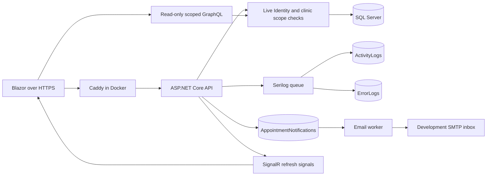

# Clinic scopes and platform services

The API and Blazor app remain separate projects. Continue starting **API and Blazor** with F5 in Visual Studio. The API applies the new `AddClinicAssignmentsUsersLogsAndNotifications` migration at startup. Existing accounts remain active; existing Staff accounts intentionally start with no clinic assignments.

## Staff clinic assignments

As an administrator, open **User management > Manage Staff and clinic assignments** (also available from **Manage clinics > View and manage staff**). Assign Staff to a registered account first, select that account under **Staff clinic assignments**, choose a clinic and select **Assign clinic**. Multiple clinics are supported. Removing an assignment immediately prevents new reads and status changes at that clinic, including with an existing cookie.

The Staff dashboard clinic selector contains only assigned clinics. REST and GraphQL independently check current account state, Staff membership and clinic assignment; changing a URL or appointment ID cannot bypass the scope. Admin membership alone does not grant Staff appointment access. Administrators can assign themselves Staff and the clinics they work in.

## User management

The sidebar shows **User management** only to active Admin or Staff accounts. Administrators can create Patient accounts, edit names, birth date and phone number, deactivate/reactivate accounts, or delete them by archiving. Email/login credentials are not changed by profile editing. Roles are assigned separately through the Staff and administrator pages.

Staff can list and edit ordinary Patient accounts that have an appointment at an assigned clinic, including historical appointments. They cannot edit other Staff/Admin accounts, create accounts, change roles, deactivate users or archive them. Patient records are shared across clinics, so permitted profile edits update the same patient record rather than creating clinic-specific copies.

Deactivation blocks sign-in and further authenticated API requests, even with an existing cookie. Reactivation preserves previous roles and clinic assignments. **Delete (archive)** is a distinct confirmed action: it marks the user deleted and inactive, prevents reactivation through the API, and retains their patient/appointment history. It does not erase clinical records. The final active administrator cannot be deactivated, archived or stripped of Admin membership. Admin role changes and account state changes share a gate and SQL serializable transactions to protect that invariant.

## Activity and error logging

Serilog writes operational output to the console and, when `DatabaseLogging:Enabled=true`, persists to two SQL tables:

| Table | Events |
| --- | --- |
| ActivityLogs | Information/Warning activity, HTTP route/method/status/timing, entity operation metadata and authorization/validation outcomes |
| ErrorLogs | Error/Fatal events with exception type and safe correlation metadata |

The database sink stores message templates plus allowlisted identifiers and operational properties. It intentionally excludes request/response bodies, passwords, cookies, authorization headers, query strings, raw exception messages, patient names and medical details. Entity auditing records entity types and operations, not field values. Database log writes are suppressed from their own sink to prevent recursion.

The sink uses a 10,000-event bounded queue and three persistence attempts. Database outages or sustained overload can lose buffered log events; a safe stderr notice reports that condition. Shutdown allows up to ten seconds to drain. These operational logs are not a guaranteed, tamper-proof clinical audit ledger. Define database access, retention and backups for your deployment rather than granting ordinary application users access to the tables.

## Development email and appointment reminders

Email uses SMTP behind `IEmailDelivery`; Mailpit provides a local inbox instead of sending real messages. Docker Compose enables it automatically. For Visual Studio, start only Mailpit using Docker Desktop/Compose and set the following in **PHCIS.Api > Manage User Secrets**:

```json
{
  "Email": {
    "Enabled": true,
    "SmtpHost": "localhost",
    "SmtpPort": 1025,
    "From": "no-reply@phcis.local",
    "ReminderLeadHours": 24,
    "EnableSsl": false
  }
}
```

The base configuration disables delivery until explicitly enabled. Open the local Mailpit inbox at http://localhost:8025. Mailpit's local SMTP port is 1025. Its inbox and SMTP host ports are bound to loopback by Compose. See the [Mailpit Docker documentation](https://mailpit.axllent.org/docs/install/docker/).

Booking/rescheduling stages confirmation and reminder records in `AppointmentNotifications` in the same EF save as the appointment. A background worker polls every 30 seconds, claims work with a two-minute lease, and sends to the current account email. A reminder is due 24 hours before attendance by default. If booking occurs within that window, it is due five minutes after booking, provided that is still before the slot starts.

Cancelled, completed, elapsed, deactivated-account and superseded-reschedule notifications are skipped. SMTP failures use increasing backoff and stop after five attempts; inspect `Status`, `Attempts`, `DueAt` and `ProcessedAt` for failed work. Delivery is at least once: a crash after SMTP accepts a message but before its sent state is saved can cause a duplicate. Worker failures do not retry or roll back the patient's booking. When using an external SMTP provider, set TLS and credentials through secrets; none are stored in the repository. No Twilio account or paid service is required for local testing.

## SignalR

The authenticated hub is `/hubs/appointments`. After a successful booking, cancellation, reschedule or staff outcome change, the server queries current recipients and sends a payload-free `AppointmentsChanged` signal to the patient account and active Staff assigned to that clinic. It does not broadcast patient data or expose client-selected groups. Removed assignments/roles and deactivated users are excluded from future recipient queries.

The Blazor client uses cookie-authenticated SignalR long polling, automatic reconnect after an established connection drops, and authorized HTTP reloads. The staff dashboard and patient's **My appointments** list refresh when signalled. Clinic access is checked again on reload. An initial failed hub connection does not block the portal; reload after restoring connectivity to connect. This implementation targets a single API instance; add an appropriate SignalR backplane/service before scaling real-time delivery across multiple instances. See [SignalR authentication](https://learn.microsoft.com/aspnet/core/signalr/authn-and-authz).

## Read-only GraphQL

`POST /graphql` supports bounded `myAppointments` and clinic-scoped `clinicAppointments` queries. There are no GraphQL mutations or user/credential table queries. The endpoint requires a current active account, cookie credentials and a valid CSRF token; GET requests and the embedded IDE are disabled. Query depth is limited to eight and paging to 100 results. Each resolver uses its own EF scope to avoid parallel DbContext operations. Exception internals are not returned.

The staff dashboard uses GraphQL when `Api:UseGraphQL=true` in frontend appsettings (enabled by default). Set it false to use the equivalent scoped REST endpoint. Example request body after obtaining a CSRF token through `/api/account/csrf`:

```json
{
  "query": "{ myAppointments(offset:0, limit:20) { id clinicName startsAt status } }"
}
```

Clinic query (replace the ID and date with an assigned clinic/day):

```graphql
{
  clinicAppointments(clinicId: "00000000-0000-0000-0000-000000000000", date: "2026-10-27", status: null, offset: 0, limit: 50) {
    items { id patientName startsAt endsAt status canFinalize }
    offset
    limit
    hasMore
  }
}
```

The GraphQL path applies the same live clinic assignment checks as REST. Patient queries derive ownership from the authenticated account, never a caller-supplied patient ID. See [Hot Chocolate endpoint configuration](https://chillicream.com/docs/hotchocolate/v15/server/endpoints/).

## Docker

The root `compose.yaml` defines separate API, Blazor/Caddy, SQL Server 2022 and Mailpit services. The Docker database uses its own named volume and does not replace your existing Windows SQL Server database. API Data Protection keys and the local Caddy certificate authority also persist in named volumes.

1. Start Docker Desktop with its Linux engine running.
2. Copy `.env.example` to an untracked `.env`. Replace both placeholders with different strong local passwords. Never commit this file.
3. From the repository root, run `docker compose up --build -d` (or start this Compose project through your Docker tooling).
4. The browser URL is https://localhost:8443/login and Mailpit is http://localhost:8025. Only loopback host ports are published; SQL Server and the API are internal to the Compose network.

Caddy uses a local development certificate authority. Before browsing, export its root with `docker compose cp web:/data/caddy/pki/authorities/local/root.crt ./docker-root.crt` and import it through your operating system's certificate manager into the trusted root store for local development. Inspect and trust only this local development CA; do not bypass browser certificate warnings. Delete the exported copy when no longer needed. The container retains its own CA in its named volume.

### Reuse an existing trusted ASP.NET development certificate

If Visual Studio HTTPS already works, this optional override lets Docker use that same localhost certificate without adding Caddy's CA to Windows trust. First verify the existing certificate; `--check --trust` checks trust without changing it:

```text
dotnet dev-certs https --check --trust
dotnet dev-certs https --export-path docker/certificates/localhost.pem --format Pem --no-password
docker compose -f compose.yaml -f compose.dev-cert.yaml up --build -d
```

Create `docker/certificates` before exporting if it does not exist. The export contains a private key, stays in this Git-ignored folder, and is mounted read-only into Caddy. Do not share or commit it. This option requires an already trusted, valid certificate; it does not install or trust one. Renew and re-export it when it expires, then restart `web`. Use both Compose files for subsequent start/recreate operations so the certificate override remains active. Ordinary `docker compose ps`, `logs`, and `stop` still address the same project.

The API honors forwarded HTTPS headers only from the configured private Compose network (172.28.0.0/24). Cookies retain their Secure/HttpOnly settings; the browser, API proxy and SignalR endpoint share the same HTTPS origin. In the container the initial administrator password comes from `PHCIS_ADMIN_PASSWORD`, while the seeded login remains `admin@phcis.local`. Assign Staff/clinics explicitly after first sign-in.

Compose uses distinct authentication/CSRF cookie names so Docker and Visual Studio sessions on localhost do not overwrite each other. Their databases and Data Protection keys also remain separate.

For Visual Studio plus only the dev email inbox, use `docker compose up -d mailpit` after creating `.env`. Continue running both .NET projects with F5. Use `docker compose stop` to stop containers. Do not use `down -v` unless you intend to remove the Docker database and other named-volume data.

The API image uses the official .NET 10 SDK/runtime and runs as the image's non-root `app` user. The frontend is a separately published static Blazor app served by Caddy. See [Microsoft's .NET container guidance](https://learn.microsoft.com/aspnet/core/host-and-deploy/docker/building-net-docker-images).

## Verification and limits

Automated tests cover clinic scope/revocation, staff patient-edit boundaries, inactive/archived sessions, last-active-admin protection, GraphQL ownership/scoping, separate redacted log persistence, outbox timing/skips, notification uniqueness, SignalR recipient selection and payload-free delivery, plus the UI management and query paths. SMTP is tested through a transport double; real delivery is inspected in Mailpit. In-memory EF tests do not prove SQL locking, so SQL Server startup/migrations are also checked separately.

Compose configuration validates successfully. Image builds and a running container smoke test require a working Docker engine; the local Docker Desktop engine did not become ready during implementation, so container execution remains unverified. No background API/frontend hosts were left running; use Visual Studio for the normal workflow.


